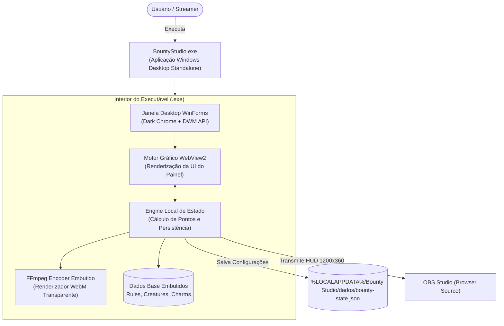

# Bounty Studio · Aplicativo Desktop (.exe)

[](https://github.com/imzallan/Bounty-Studio/raw/refs/heads/main/BountyStudio.exe)
[](https://github.com/imzallan/Bounty-Studio/actions/workflows/ci.yml)
[](LICENSE)
[](https://microsoft.com/windows)

**Bounty Studio** é um **aplicativo desktop standalone executável (`.exe`)** para Windows, desenvolvido para streamers de Tibia / RubinOT. O programa integra em um único executável portátil o painel de controle da live, o motor de cálculo do **Bounty Talisman** e da **Preferred List**, o codificador de mídia transparente e o gerador de overlay para o OBS Studio.

Não exige instalação, nem Python, nem privilégios de administrador.

---

## 💾 Baixar e Usar o Aplicativo

O executável portátil compilado e pronto para uso está disponível diretamente na raiz deste repositório:

👉 **[Baixar BountyStudio.exe](https://github.com/imzallan/Bounty-Studio/raw/refs/heads/main/BountyStudio.exe)**

### Como Executar:
1. Salve o arquivo `BountyStudio.exe` em uma pasta com permissão de escrita (como `Downloads`, `Área de Trabalho` ou `%LOCALAPPDATA%`).
2. Dê duplo clique em **`BountyStudio.exe`**.
3. A janela desktop do aplicativo abrirá diretamente com a interface de controle.
4. O aplicativo consulta automaticamente atualizações estáveis no GitHub ao ser iniciado.

> **Requisito**: Windows 10 ou 11 com o *Microsoft WebView2 Runtime* (já presente nativamente na grande maioria dos computadores modernos).

---

## 🖥 O Que o Aplicativo Desktop Faz

- **Janela de Controle Standalone**: Interface desktop moderna com tema escuro nativo (DWM Mica/Dark Caption), controles táteis de atributos e visualização em tempo real.
- **HUD Transparente para OBS Studio**: O aplicativo gera localmente uma transmissão de overlay em 1200 × 360 px com animações fluidas, cycling dinâmico de slides e sprites animados em pixel-art das criaturas.
- **Gerenciador de Bônus e Pontos**: Cálculo automático de custo de progressão para Damage (até 50%), Leech (até 50%), Loot (até 50%), Bestiary (até 100%) e desbloqueio dos 5 slots da Preferred List.
- **Exportador Integrado de Vídeo Transparente**: Motor FFmpeg embutido dentro do executável para renderizar e salvar clipes `.webm` com transparência real (canal alfa) e imagens `.png`.
- **Auto-Atualizador Seguro**: Atualização direta por download HTTPS e conferência criptográfica SHA-256 informada pela API de Releases do GitHub, sem solicitar elevação de privilégios.

---

## 🏛 Arquitetura do Aplicativo (`BountyStudio.exe`)



---

## 📺 Integrando o Aplicativo com o OBS Studio

Com o **`BountyStudio.exe`** aberto:

1. No OBS Studio, adicione uma nova fonte do tipo **Navegador** (Browser Source).
2. Preencha a URL com:
   ```text
   http://127.0.0.1:8787/overlay
   ```
3. Defina as dimensões:
   - **Largura**: `1200`
   - **Altura**: `360`
4. O HUD transparente aparecerá imediatamente na sua cena, sincronizado em tempo real com os ajustes feitos na janela do aplicativo.

---

## 🔨 Compilando o Executável a Partir do Código-Fonte

O projeto adota o compilador `csc.exe` embutido nativamente em qualquer Windows com .NET Framework 4.8. Não é necessário instalar SDKs pesados.

Para compilar um novo `BountyStudio.exe`:

```powershell
./scripts/build.ps1
```

O script empacota todos os componentes internos (interface, motor, dados e codificador de vídeo) em um binário único e autossuficiente:
- Binário de distribuição: `dist/BountyStudio.exe`
- Binário raiz atualizado: `./BountyStudio.exe`

Para compilar especificando a versão e o repositório de atualização do GitHub:
```powershell
./scripts/build.ps1 -Version 1.0.1 -GitHubRepository imzallan/Bounty-Studio
```

---

## 🧪 Testes Automatizados

O repositório possui uma suíte rigorosa de 38 testes para garantir a integridade dos cálculos do aplicativo:

```powershell
./scripts/test.ps1
```

- **Testes Unitários de Regras (`tests/Test-BountyRules.ps1`)**:
  - Valida as faixas de custo progressivo (`initialCost`, `costStep`).
  - Valida os limites máximos de atributos (Damage, Leech e Loot em 50%, Bestiary em 100%).
  - Valida o custo total de desbloqueio de slots (3.000 pontos).
- **Testes de Integração da Engine (`tests/Test-ServerApi.ps1`)**:
  - Valida o ciclo de vida do motor interno, integridade do estado e persistência atômica.

---

## 📂 Organização do Repositório

```text
├── BountyStudio.exe           Executável Windows pronto para uso (distribuição direta)
├── BountyStudio.sln           Solução para Visual Studio / VS Code / Rider
├── INICIAR_WINDOWS.bat        Launcher auxiliar para Windows
├── INICIAR_MAC_LINUX.command  Launcher auxiliar para Unix/macOS
├── CONTRIBUTING.md            Diretrizes de desenvolvimento e código
├── README.md                  Documentação oficial do aplicativo
├── scripts/
│   ├── build.ps1              Compilação do executável BountyStudio.exe
│   ├── test.ps1               Suíte unificada de testes automatizados
│   ├── dev.ps1                Execução em ambiente de desenvolvimento
│   ├── bundle-web.ps1         Sincronização de dados embutidos
│   └── clean.ps1              Limpeza de temporários e artefatos de build
├── src/
│   ├── BountyStudio.Desktop/  Código-fonte C# da aplicação desktop (Janela, Shell, Updater)
│   ├── BountyStudio.Server/   Engine interna de IPC, estado e codificação
│   ├── BountyStudio.Shared/   Fonte única de dados (schemas JSON de regras e bestiário)
│   └── BountyStudio.Web/      Assets visuais renderizados pela janela do aplicativo
└── tests/                     Suíte de testes de regras matemáticas e integração
```

---

## 📄 Licença

Distribuído sob a licença [MIT](LICENSE). Componentes integrados de terceiros (FFmpeg e WebView2) mantêm suas respectivas licenças; consulte [docs/CREDITOS.md](docs/CREDITOS.md).
